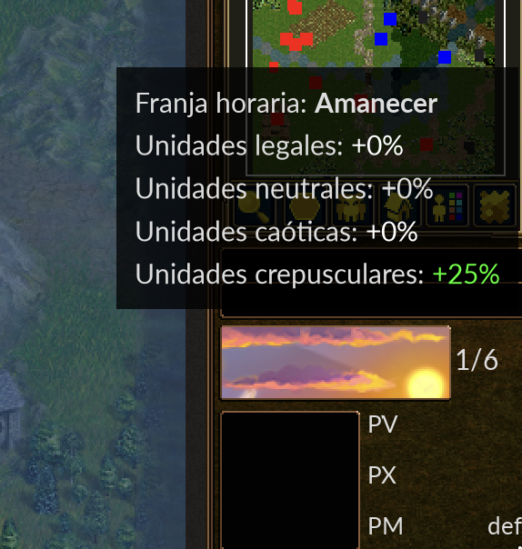
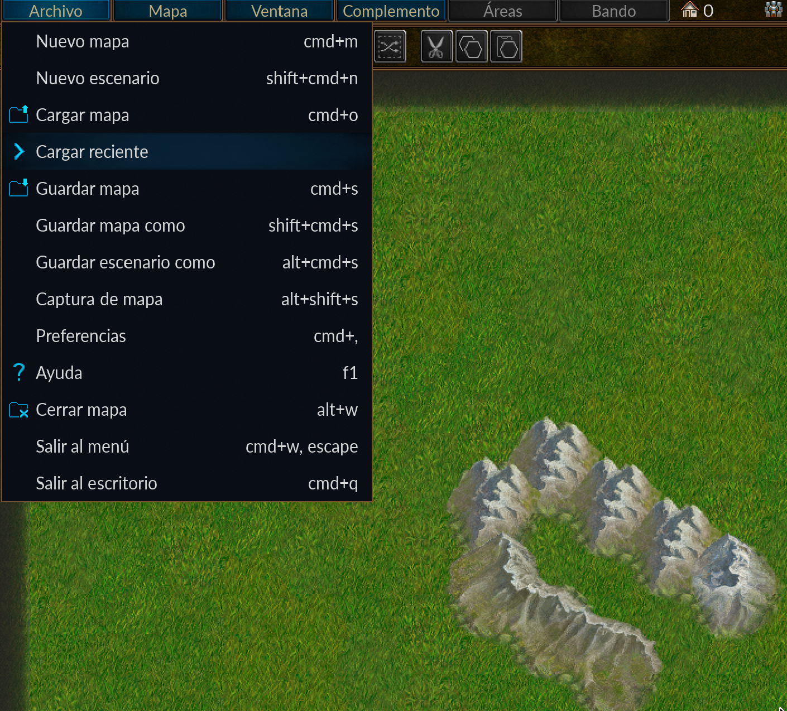

# Informe consolidado — Localization QA del editor de mapas

## 1. Resumen

Se evaluó la localización al español (es) del dominio wesnoth-editor en el snapshot 1.19.29. El piloto cubrió 10 entradas y la auditoría extendida cubrió las 112 entradas vigentes restantes. La decisión humana final confirma 9 hallazgos, ME-001–ME-009. ME-008 cuenta como un hallazgo que afecta cuatro cadenas. En la fase extendida, seis hallazgos nuevos afectan nueve entradas; 102 entradas no presentaron defecto y el registro 087 se conserva únicamente como sugerencia estilística.

### Severidad e impacto

**Baja:** problema lingüístico o de consistencia sin cambio importante de comprensión o comportamiento. **Media:** puede causar confusión o información incorrecta. **Alta:** puede afectar de forma relevante la integridad de placeholders, el formato o la presentación. La severidad estima el impacto observable o probable con la evidencia estática disponible; no representa un fallo funcional comprobado. No se asignó severidad alta: ME-003 y ME-005 merecen atención por sus escapes/placeholders, pero el posible efecto de presentación no se verificó en ejecución y no hay evidencia de daño grave.

| Hallazgo | Severidad | Justificación |
|---|---|---|
| ME-001 | Baja | La concordancia es incorrecta, pero el contenido del aviso se entiende. |
| ME-002 | Media | Se identifica como fallido el objeto equivocado, lo que puede inducir a error sobre la operación. |
| ME-003 | Media | Se altera la separación prevista y puede aparecer `/n` literal; sin ejecución no se confirmó su presentación real. |
| ME-004 | Baja | La expresión actual es menos adecuada al concepto usado por la interfaz, aunque el mensaje se comprende. |
| ME-005 | Media | El placeholder adicional puede afectar la lectura del mensaje o del nombre de archivo; el efecto exacto no se verificó en ejecución. |
| ME-006 | Baja | La coma es impropia en la enumeración, sin cambiar su interpretación funcional. |
| ME-007 | Baja | Hay discordancia de género y forma inconsistente de `ID`, pero se reconoce el identificador mencionado. |
| ME-008 | Baja | El guion y la inconsistencia afectan cuatro instrucciones; las acciones descritas siguen siendo comprensibles. |
| ME-009 | Media | “Cargar reciente” no explica con claridad el contenido del submenú y puede dificultar anticipar la acción. |

Distribución: **5 bajas + 4 medias + 0 altas = 9 hallazgos**.

## 2. Alcance y archivos

- Juego: The Battle for Wesnoth.
- Versión/tag: 1.19.29.
- Commit: [0e0c7174265d120d09455adfbcc4b0fd62a80433](https://github.com/wesnoth/wesnoth/commit/0e0c7174265d120d09455adfbcc4b0fd62a80433).
- Dominio: wesnoth-editor.
- Dirección: inglés → español (es).
- Catálogos: [po/wesnoth-editor/wesnoth-editor.pot](https://github.com/wesnoth/wesnoth/blob/0e0c7174265d120d09455adfbcc4b0fd62a80433/po/wesnoth-editor/wesnoth-editor.pot) y [po/wesnoth-editor/es.po](https://github.com/wesnoth/wesnoth/blob/0e0c7174265d120d09455adfbcc4b0fd62a80433/po/wesnoth-editor/es.po).
- El código fuente citado en cada hallazgo se consultó en el mismo commit.

### Inventario

| Métrica | es.po | POT |
|---|---:|---:|
| Líneas físicas | 747 | 587 |
| Entradas vigentes, sin cabecera | 122 | 122 |
| Entradas totales del archivo, incluidas obsoletas y sin cabecera | 161 | 122 |
| Traducidas | 122 | No aplica: plantilla |
| Vacías | 0 | 122 msgstr vacíos esperados |
| fuzzy vigentes | 0 | 0 |
| Obsoletas | 39 | 0 |
| Obsoletas con flag fuzzy | 3 | 0 |
| Entradas cubiertas por el piloto | 10 | — |
| Entradas nuevas revisadas | 112 | — |

El conteo excluye la entrada de cabecera. Las entradas obsoletas se identificaron por la sintaxis #~; el estado fuzzy se contó por su flag y no se mezcló con obsoletas. Las cadenas PO multilínea se interpretaron concatenando sus segmentos y decodificando escapes. Las capturas no se incluyeron en el conteo de entradas.

La comparación de claves gettext vigentes (`msgctxt`, `msgid` y `msgid_plural`) confirma 122 claves únicas en cada archivo y ninguna diferencia entre el PO y el POT. Las tres entradas `fuzzy` están entre las 39 obsoletas; no hay entradas vigentes fuzzy ni vacías.

### Conciliación del piloto y la auditoría extendida

| Alcance y disposición final | Entradas afectadas por hallazgos | Sin defecto identificado | Sugerencia estilística | Total de entradas |
|---|---:|---:|---:|---:|
| Piloto: 10 entradas | 3 | 7 | 0 | 10 |
| Auditoría extendida: 112 entradas | 9 | 102 | 1 | 112 |
| Total revisado | 12 | 109 | 1 | 122 |

Los conteos de la tabla son de **entradas PO**, no de identificadores de hallazgo. La auditoría extendida produjo seis hallazgos nuevos (ME-004–ME-009), pero afectan nueve entradas: ME-004, ME-005, ME-006, ME-007 y ME-009 afectan una cada uno, y ME-008 afecta cuatro. Por eso `6 + 102 + 1 = 109` no era una suma válida de categorías de entradas: `6` cuenta hallazgos, no entradas afectadas. La reconciliación correcta es `9 + 102 + 1 = 112`; ME-008 aporta tres entradas adicionales a su único ID de hallazgo.

La disposición inicial del registro extendido fue de ocho entradas con defectos confirmados (registros 056, 088, 092, 106 y 108–111), 102 sin defecto y dos pendientes (031 y 087): `8 + 102 + 2 = 112`. La revisión humana resolvió ambos pendientes: 031 se confirmó como ME-009 y 087 quedó como sugerencia estilística. La disposición final es por tanto nueve entradas con hallazgos, 102 sin defecto, una sugerencia y cero pendientes. La elipsis inglesa consultada dentro de ME-009 es una consulta de Source Language QA / UX Writing, no una entrada PO ni un hallazgo adicional.

No se documentan otros candidatos descartados. El registro 087 no se eliminó ni se contó como defecto: permanece clasificado como sugerencia estilística.

Para rastrear las 112 entradas individuales, la [copia sin alterar del registro original de auditoría extendida](Reference/Map-Editor-QA-Extended-Audit.md) enumera los registros 001–112. Las entradas afectadas en la disposición final son 031, 056, 088, 092, 106 y 108–111; la sugerencia es 087; los demás 102 registros quedan como “sin defecto identificado”. El registro original repite 031 y 087 en su tabla preliminar de casos pendientes además de sus filas detalladas; esas dos menciones explican que haya 114 apariciones de número, pero solo 112 registros únicos. La disposición final de 031 y 087 aquí indicada reemplaza su estado inicial de pendiente.

En el proyecto completo hay nueve IDs de hallazgo confirmados: tres del piloto y seis de la ampliación. Estos afectan 12 entradas PO (tres del piloto y nueve de la ampliación). Siete entradas del piloto y 102 de la ampliación —109 en total— no presentaron defecto identificado. El registro 087 es la única sugerencia estilística de entrada contabilizada; la consulta sobre el texto fuente inglés de ME-009 se mantiene separada y no se suma a las categorías de entradas.

## 3. Método y trayectoria de revisión

### Materiales consultados

- Catálogo español `po/wesnoth-editor/es.po` y plantilla inglesa `po/wesnoth-editor/wesnoth-editor.pot` del commit indicado en la sección 2.
- Código fuente y configuración de interfaz citados junto a cada hallazgo, consultados en el mismo commit.
- Dos capturas de interfaz aportadas por la persona usuaria, vinculadas a ME-004 y ME-009.
- Copia de trazabilidad del registro extendido original en [Reference/Map-Editor-QA-Extended-Audit.md](Reference/Map-Editor-QA-Extended-Audit.md); sus clasificaciones iniciales de 031 y 087 se conservan sin alterar y las decisiones finales se indican en este informe.

La auditoría fue estática y documental: no se ejecutó el juego ni se hicieron pruebas funcionales.

1. Se fijó la versión mediante la etiqueta y el commit indicados; se compararon los catálogos con el snapshot.
2. Se seleccionaron 10 cadenas representativas para el piloto y se contrastaron originales, traducciones y referencias de código.
3. Se validaron los primeros tres hallazgos y después se revisaron las 112 entradas vigentes restantes, registrando también las entradas sin defecto.
4. El agente señaló candidatos mediante comparación lingüística y estructural —incluidos placeholders, marcado y saltos de línea— y consultó el código para precisar función y presentación.
5. La persona usuaria revisó las propuestas y fijó el resultado final. La revisión visual influyó directamente en ME-004 y ME-009; el registro 087 se rebajó a nota estilística.

El proceso fue evidencia estática más contexto visual aportado por la persona. No se atribuyen al agente decisiones que tomó la persona usuaria.

### Evaluación del proceso agéntico y decisiones humanas

**Tareas realizadas por el agente:** exploró el snapshot, localizó y comparó originales y traducciones, revisó placeholders, escapes, puntuación y consistencia, consultó el código para determinar el contexto de uso y documentó candidatos junto con entradas sin defecto identificado. El análisis extendido produjo cinco candidatos nuevos y dejó dos casos pendientes de juicio humano.

**Intervención humana:** la persona usuaria validó o rechazó propuestas, decidió la terminología y naturalidad final, aportó las capturas y determinó qué registrar como bug o sugerencia. Fijó “planificación de fases horarias” para ME-002; reemplazó “tiempo del día” por “franja horaria” en ME-004; confirmó ME-009 como defecto de localización española tras revisar el menú; y mantuvo la elipsis inglesa como consulta separada de Source Language QA / UX Writing. También descartó el registro 087 como bug y confirmó que ME-008 debía contarse como un hallazgo que afecta cuatro cadenas.

**Evaluación del desempeño y límites:** la comparación de cadenas, la detección de discrepancias lingüísticas y estructurales y la consulta de código fueron útiles para producir candidatos verificables. El agente no pudo decidir por sí solo la terminología preferida ni la naturalidad contextual de ME-004 y ME-009; esas conclusiones cambiaron con la retroalimentación y evidencia visual humanas. El análisis estático tampoco demuestra cómo se muestran todas las cadenas en ejecución ni confirma consecuencias funcionales. Las capturas apoyan el uso visible de “Franja horaria” y el carácter de submenú de ME-009, pero no prueban traducciones corregidas instaladas.

## 4. Antecedentes del piloto

Estos tres hallazgos ya habían sido validados. Se incluyen para completar el conteo consolidado y no se vuelven a contar como hallazgos nuevos de la auditoría extendida.

### ME-001 — Concordancia gramatical

- Original: Loaded embedded map data
- Traducción actual: Cargado los datos de mapa incrustados
- Ubicación: [es.po:454–455](https://github.com/wesnoth/wesnoth/blob/0e0c7174265d120d09455adfbcc4b0fd62a80433/po/wesnoth-editor/es.po#L454-L455); [context_manager.cpp:955–957](https://github.com/wesnoth/wesnoth/blob/0e0c7174265d120d09455adfbcc4b0fd62a80433/src/editor/map/context_manager.cpp#L955-L957).
- Evidencia: el participio singular Cargado no concuerda con el sujeto plural los datos; el mensaje se usa como cuerpo de una notificación transitoria.
- Categoría e impacto potencial: gramática; reduce la naturalidad de un mensaje visible, sin impacto funcional identificado.
- Estado: confirmado y validado.
- Corrección propuesta: Se cargaron los datos de mapa incrustados.

### ME-002 — Error semántico

- Original: Could not save time schedule: $msg
- Traducción actual: No se pudo guardar el escenario: $msg
- Ubicación: [es.po:519–524](https://github.com/wesnoth/wesnoth/blob/0e0c7174265d120d09455adfbcc4b0fd62a80433/po/wesnoth-editor/es.po#L519-L524); [map_context.cpp:814–875](https://github.com/wesnoth/wesnoth/blob/0e0c7174265d120d09455adfbcc4b0fd62a80433/src/editor/map/map_context.cpp#L814-L875).
- Evidencia: la función guarda el horario en utils/schedule.cfg; el texto actual dice que no se pudo guardar el escenario. El placeholder $msg se conserva.
- Categoría e impacto potencial: error semántico; puede informar incorrectamente qué operación falló.
- Estado: confirmado y validado.
- Corrección: No se pudo guardar la planificación de fases horarias: $msg.
- Decisión terminológica humana: time schedule → planificación de fases horarias.

### ME-003 — Integridad de saltos de línea

- Original: Failed to load the scenario: $error\n\nAttempting to load only the map.
- Traducción actual: No se pudo cargar el escenario: $error\n/nIntentando cargar solo el mapa.
- Ubicación: [es.po:489–496](https://github.com/wesnoth/wesnoth/blob/0e0c7174265d120d09455adfbcc4b0fd62a80433/po/wesnoth-editor/es.po#L489-L496); [map_context.cpp:221–228](https://github.com/wesnoth/wesnoth/blob/0e0c7174265d120d09455adfbcc4b0fd62a80433/src/editor/map/map_context.cpp#L221-L228).
- Evidencia: el texto fuente contiene dos escapes \n; el msgstr contiene un escape \n seguido del texto literal /n. El mensaje se construye con VGETTEXT y se muestra como diálogo de error.
- Categoría e impacto potencial: integridad de formato; se pierde la separación prevista y puede aparecer /n literal en el diálogo.
- Estado: confirmado y validado.
- Corrección propuesta: No se pudo cargar el escenario: $error\n\nIntentando cargar solo el mapa.; conservar $error.

## 5. Hallazgos confirmados de la auditoría extendida

### ME-004 — Terminología: time-of-day

- Original: No editor time-of-day found.
- Traducción actual: No se encontraron datos de la «hora del día» para el editor.
- Ubicación: [es.po:310–312](https://github.com/wesnoth/wesnoth/blob/0e0c7174265d120d09455adfbcc4b0fd62a80433/po/wesnoth-editor/es.po#L310-L312); [editor_controller.cpp:252–256](https://github.com/wesnoth/wesnoth/blob/0e0c7174265d120d09455adfbcc4b0fd62a80433/src/editor/controller/editor_controller.cpp#L252-L256).
- Evidencia estática: se muestra cuando la lista de franjas horarias del editor está vacía.
- Categoría e impacto potencial: terminología; una denominación distinta puede confundir la función de gameplay.
- Estado: confirmado por decisión humana.
- Decisión humana y corrección aprobada: El editor no tiene ninguna franja horaria definida.
- Contexto visual: la interfaz muestra “Franja horaria: Amanecer”, visible en [la captura de ME-004](Evidence/ME-004-Franja-horaria-Amanecer.png). La primera propuesta del agente, “tiempo del día”, no se conserva.

### ME-005 — Placeholder añadido sin correspondencia

- Original: Loaded referenced map file:
- Traducción actual: Archivo de mapa referenciado cargado:\n$new
- Ubicación: [es.po:462–466](https://github.com/wesnoth/wesnoth/blob/0e0c7174265d120d09455adfbcc4b0fd62a80433/po/wesnoth-editor/es.po#L462-L466); [context_manager.cpp:958–960](https://github.com/wesnoth/wesnoth/blob/0e0c7174265d120d09455adfbcc4b0fd62a80433/src/editor/map/context_manager.cpp#L958-L960).
- Evidencia: el original no contiene $new; el código concatena el nombre real del archivo por separado después de la etiqueta.
- Categoría e impacto potencial: integridad de placeholder; el marcador extra podría mostrarse literalmente y entorpecer la lectura de la ruta.
- Estado: confirmado por decisión humana.
- Corrección propuesta: Archivo de mapa referenciado cargado:.

### ME-006 — Puntuación

- Original: File does not have .map, .cfg, or .mask extension
- Traducción actual: El archivo no tiene extensión .map, .cfg, o .mask
- Ubicación: [es.po:485–487](https://github.com/wesnoth/wesnoth/blob/0e0c7174265d120d09455adfbcc4b0fd62a80433/po/wesnoth-editor/es.po#L485-L487); [map_context.cpp:199–205](https://github.com/wesnoth/wesnoth/blob/0e0c7174265d120d09455adfbcc4b0fd62a80433/src/editor/map/map_context.cpp#L199-L205).
- Evidencia: coma innecesaria antes de la conjunción final en una enumeración simple de extensiones.
- Categoría e impacto potencial: puntuación; afecta la corrección lingüística, no la comprensión funcional.
- Estado: confirmado por decisión humana.
- Corrección propuesta: El archivo no tiene extensión .map, .cfg o .mask.

### ME-007 — Concordancia de género

- Original: Invalid location id
- Traducción actual: Id de posición no válida
- Ubicación: [es.po:566–568](https://github.com/wesnoth/wesnoth/blob/0e0c7174265d120d09455adfbcc4b0fd62a80433/po/wesnoth-editor/es.po#L566-L568); [location_palette.cpp:254–268](https://github.com/wesnoth/wesnoth/blob/0e0c7174265d120d09455adfbcc4b0fd62a80433/src/editor/palette/location_palette.cpp#L254-L268).
- Evidencia: el mensaje señala que no es válido el identificador ingresado. El mismo catálogo usa “Cambiar el ID de la unidad”, con núcleo masculino.
- Categoría e impacto potencial: concordancia y claridad; puede hacer que el adjetivo parezca referirse a la posición y no al identificador.
- Estado: confirmado por decisión humana.
- Corrección recomendada: ID de posición no válido.

### ME-008 — Guion en clic izquierdo/derecho (un hallazgo, cuatro cadenas)

Ubicación de las cuatro cadenas: [es.po:574–591](https://github.com/wesnoth/wesnoth/blob/0e0c7174265d120d09455adfbcc4b0fd62a80433/po/wesnoth-editor/es.po#L574-L591); [terrain_palettes.cpp:221–232](https://github.com/wesnoth/wesnoth/blob/0e0c7174265d120d09455adfbcc4b0fd62a80433/src/editor/palette/terrain_palettes.cpp#L221-L232).

| Original | Traducción actual | Corrección propuesta |
|---|---|---|
| Left-click: | Clic-izquierdo: | Clic izquierdo: |
| Right-click: | Clic-derecho: | Clic derecho: |
| Shift + left-click: paint overlay layer only | Mayúsculas + clic-izquierdo: solo dibuja una capa superpuesta | Mayúsculas + clic izquierdo: solo dibuja una capa superpuesta |
| Shift + left-click: paint base layer only | Mayúsculas + clic-izquierdo: solo dibuja una capa base | Mayúsculas + clic izquierdo: solo dibuja una capa base |

El defecto es la forma con guion y la inconsistencia con “Clic izquierdo”/“Clic derecho” ya presentes en el catálogo. Estas cuatro cadenas cuentan como un único hallazgo ME-008.

- Categoría e impacto potencial: ortografía y consistencia; reduce la uniformidad de las instrucciones de interacción.
- Estado: confirmado por decisión humana.

### ME-009 — Traducción ambigua del título de submenú

- Original: Load Recent
- Traducción actual: Cargar reciente
- Ubicación: [es.po:186–189](https://github.com/wesnoth/wesnoth/blob/0e0c7174265d120d09455adfbcc4b0fd62a80433/po/wesnoth-editor/es.po#L186-L189); [editor.cfg:71–76](https://github.com/wesnoth/wesnoth/blob/0e0c7174265d120d09455adfbcc4b0fd62a80433/data/themes/editor.cfg#L71-L76).
- Evidencia estática: el título pertenece al menú identificado como menu-editor-recent, con elementos recientes generados dinámicamente.
- Ámbito y categoría: defecto de Localization QA en el msgstr español; claridad del rótulo de interfaz.
- Impacto potencial: “Cargar reciente” resulta elíptico y puede leerse como una acción sobre un único elemento, aunque el contexto es un submenú de elementos recientes.
- Estado: confirmado por decisión humana tras revisar el contexto visual.
- Evidencia visual: la captura muestra la opción en Archivo con indicador de submenú: [captura ME-009](Evidence/ME-009-Submenu-Cargar-reciente.png).
- Corrección de localización propuesta: Cargar archivos recientes.

#### Consulta separada de Source Language QA / UX Writing — no es un bug confirmado del original

El original inglés “Load Recent” también es una etiqueta elíptica que omite el sustantivo. Esta observación no se suma al conteo de defectos ni cambia el estado de ME-009. Se propone consultar al responsable del texto fuente si conviene explicitar la acción:

- “Load Recent Files” si el submenú presenta varios archivos.
- “Load Recent File” si la opción selecciona un único archivo.

Hasta confirmar el comportamiento previsto y obtener criterio del responsable del original, estas alternativas son una consulta y posibles sugerencias estilísticas de UX Writing, no un defecto confirmado del inglés.

## 6. Registro 087 — nota estilística, no bug

- Original: Map loaded from scenario
- Traducción: Mapa cargado desde escenario
- Se consideró la variante “Mapa cargado desde el escenario”, pero no se confirmó un defecto. Se mantiene solo como sugerencia estilística y no forma parte del conteo de nueve hallazgos.

## 7. Limitaciones

- El análisis de catálogo y código fue estático. No se compiló el juego ni se ejecutó una prueba completa del editor durante esta revisión.
- Las dos capturas son evidencia de contexto visual aportada por la persona usuaria; no se recortaron, redimensionaron ni alteraron. Documentan ME-004 y ME-009, no todos los hallazgos.
- El catálogo tiene 122 entradas vigentes, 39 obsoletas y las fechas de sus cabeceras son anteriores al snapshot. La auditoría cubrió el catálogo incluido en el commit, sin afirmar que fuera actualizado después de esas fechas.
- Las correcciones se presentan para revisión; no se aplicaron a los archivos originales de Wesnoth.

## 8. Conclusión

La combinación de revisión estática y evidencia visual permitió separar candidatos de defectos confirmados y reflejar decisiones humanas en el resultado final. El resultado es de nueve hallazgos confirmados (tres del piloto y seis nuevos), que afectan 12 entradas; 109 entradas no presentan defecto y una queda como sugerencia estilística. ME-008 se cuenta una sola vez aunque afecta cuatro cadenas. No quedan casos pendientes. Las correcciones son propuestas documentadas y no se aplicaron a archivos originales de Wesnoth.
