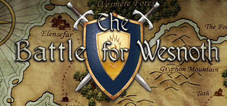

# Proyecto 04 — The Battle for Wesnoth: Agentic Localization QA

 

  

 

Estudio de caso independiente de Localization QA (QA de localización) y Agentic QA (QA con apoyo de un agente), centrado en la interfaz del editor de mapas de *The Battle for Wesnoth*. El trabajo combina comparación de catálogo y código fuente con revisión humana y evidencia visual contextual.

---

## Ficha del proyecto

| Campo | Detalle |
|---|---|
| Juego | The Battle for Wesnoth |
| Versión | 1.19.29 |
| Commit del snapshot | 0e0c7174265d120d09455adfbcc4b0fd62a80433 |
| Dominio | wesnoth-editor |
| Dirección | Inglés → español (es) |
| Tipo de revisión | Localization QA estática + validación visual contextual |
| Estado | Proyecto de portafolio |

El Proyecto 04 amplía el trabajo del Proyecto 03 con un alcance acotado al editor de mapas y hace visible la supervisión humana del flujo agéntico.

## Objetivo y alcance

Revisar el catálogo español del dominio wesnoth-editor contra el original inglés y el código de la misma versión. Se cubrieron 10 entradas en el piloto y las 112 entradas vigentes restantes en la auditoría extendida: 122 entradas únicas en total. La revisión consideró sentido, gramática, puntuación, terminología, placeholders, escapes y contexto de interfaz.

El inventario distingue 122 entradas vigentes de 39 obsoletas; las 122 vigentes tienen traducción no vacía y no fuzzy, y sus claves coinciden con la plantilla POT. Las obsoletas no se mezclan con las vigentes. Las capturas aportadas por el usuario se incorporaron solo como evidencia del contexto visual de ME-004 y ME-009.

## Materiales y metodología

Se consultaron el catálogo español `po/wesnoth-editor/es.po`, la plantilla inglesa `po/wesnoth-editor/wesnoth-editor.pot` y el código fuente del commit fijado en la ficha. También se revisaron las dos capturas de interfaz aportadas por la persona usuaria. La revisión fue estática: se compararon cadenas y contexto de código, se comprobaron concordancia, terminología, puntuación, placeholders, escapes y consistencia, y se registraron entradas sin problema identificado. Las capturas sirvieron para validar el uso visible de términos y la jerarquía del menú.

## Resultado final con validación humana

- 9 hallazgos confirmados, ME-001 a ME-009.
- ME-008 es un solo hallazgo que afecta cuatro cadenas de ayuda.
- El piloto cubrió 10 entradas: 3 entradas afectadas por los tres hallazgos iniciales y 7 sin defecto identificado.
- La ampliación cubrió 112 entradas: 6 hallazgos nuevos que afectan 9 entradas, 102 entradas sin defecto identificado y una sugerencia estilística en la entrada 087, que no se cuenta como bug.
- En todo el alcance, 12 entradas están afectadas por hallazgos confirmados, 109 no presentan defecto identificado y 1 queda como sugerencia estilística: 12 + 109 + 1 = 122.
- Los dos casos que quedaron pendientes en la primera versión del registro extendido ya se resolvieron: 031 pasó a ME-009 confirmado y 087 quedó como sugerencia estilística. No quedan casos pendientes ni otros candidatos descartados documentados.
- ME-009 también genera una consulta separada sobre el original inglés; no es otro hallazgo ni una entrada PO adicional.
- No se modificaron catálogos ni archivos fuente de Wesnoth.

La aparente discrepancia `6 + 102 + 1 = 109` mezcla hallazgos con entradas. Los seis identificadores nuevos afectan nueve entradas porque ME-008 agrupa cuatro cadenas (tres más que su cuenta como un hallazgo). Así, `9 + 102 + 1 = 112`. El [registro de auditoría extendida](Reference/Map-Editor-QA-Extended-Audit.md) conserva las 112 entradas únicas y sus estados iniciales; las entradas 031 y 087 aparecen también en una tabla previa de candidatos, por lo que el documento tiene 114 menciones de fila, pero no 114 entradas distintas. La revisión humana reclasificó 031 como ME-009 confirmado y 087 como sugerencia estilística.

### Severidad e impacto

**Baja:** problema lingüístico o de consistencia sin cambio importante de comprensión o comportamiento. **Media:** puede causar confusión o información incorrecta. **Alta:** puede afectar de forma relevante la integridad de placeholders, el formato o la presentación. La severidad refleja el impacto observable o probable en esta revisión estática; no implica un fallo funcional comprobado.

| Hallazgo | Severidad | Justificación breve |
|---|---|---|
| ME-001 | Baja | Error de concordancia; el sentido del aviso sigue siendo claro. |
| ME-002 | Media | Nombra el objeto equivocado y puede informar de forma engañosa qué operación falló. |
| ME-003 | Media | La secuencia de escapes altera la separación y puede dejar `/n` visible; no se verificó en ejecución. |
| ME-004 | Baja | La terminología es menos adecuada al contexto, pero el aviso se entiende. |
| ME-005 | Media | Añade un placeholder sin correspondencia que puede interferir con la presentación del nombre del archivo. |
| ME-006 | Baja | Coma impropia en la enumeración; no cambia qué extensiones se mencionan. |
| ME-007 | Baja | Discordancia de género y forma inconsistente de `ID`; el identificador sigue siendo reconocible. |
| ME-008 | Baja | Guion y falta de consistencia en cuatro instrucciones; las acciones siguen siendo comprensibles. |
| ME-009 | Media | El rótulo español del submenú es elíptico y puede dificultar anticipar qué contiene. |

Distribución: **5 bajas + 4 medias + 0 altas = 9 hallazgos**.

## Relación con el Proyecto 03

Se conservaron convenciones útiles del Proyecto 03: ficha de alcance, resumen de resultados, clasificación explícita de defectos confirmados, explicación del método y evidencia visual vinculada desde el informe. Para darle identidad propia al Proyecto 04, el centro es Agentic QA y la revisión humana de propuestas; los nueve hallazgos se consolidan en un único Audit-Report.md en lugar de separarlos en varios registros temáticos. Consulta el [Proyecto 03 — The Battle for Wesnoth – Localization QA](https://github.com/n7wx9m44q9-create/QA-Portfolio/tree/main/03-The%20Battle%20for%20Wesnoth%20-%20Localization%20QA) y el [repositorio oficial de Wesnoth](https://github.com/wesnoth/wesnoth).

## Evaluación del proceso de Agentic QA

**Tareas del agente:** exploró el snapshot y localizó las cadenas; comparó originales y traducciones; revisó placeholders, escapes, puntuación y consistencia; consultó el código y la configuración para entender el contexto; y documentó candidatos y entradas sin defecto identificado.

**Supervisión humana:** la persona usuaria validó o rechazó candidatos, decidió la terminología y naturalidad de las propuestas, aportó las capturas, corrigió propuestas y determinó qué registrar como bug o sugerencia. Fijó “planificación de fases horarias” para ME-002 y “franja horaria” para ME-004; confirmó ME-009 como defecto de la traducción española y dejó la elipsis inglesa como consulta separada; y descartó el registro 087 como bug.

**Evaluación:** el agente resolvió correctamente la localización y comparación estructural de las cadenas, detectó varios problemas lingüísticos y de placeholders, y consultó el código pertinente. No determinó por sí solo la terminología preferida, la naturalidad contextual de ME-004 ni el alcance de ME-009; esas propuestas requirieron criterio y evidencia visual humanos. El análisis estático tampoco permitió comprobar cómo se muestran todas las cadenas en ejecución ni confirmar efectos funcionales. La retroalimentación humana cambió la propuesta de ME-004, confirmó ME-009 dentro de Localization QA, separó la sugerencia inglesa de UX Writing y mantuvo el registro 087 fuera del conteo.

La inspección visual complementó la revisión estática: el código explica qué hace el mensaje, mientras que las capturas muestran el lenguaje y la estructura que la persona ve en pantalla. Las imágenes no se trataron como prueba de correcciones implementadas.

## Decisiones que cambiaron el resultado

- Para ME-004, la propuesta inicial del agente “tiempo del día” se sustituyó por la decisión humana “franja horaria”, respaldada por “Franja horaria: Amanecer” en la captura.
- Para ME-009, “Cargar reciente” se confirmó como defecto de localización al comprobar visualmente que es el rótulo de un submenú; se propone “Cargar archivos recientes”. La elipsis de “Load Recent” se registra aparte como consulta y posible sugerencia estilística de UX Writing, no como defecto confirmado del original.
- La posible mejora “Mapa cargado desde el escenario” para el registro 087 quedó como sugerencia estilística; no se contabilizó como bug.
- ME-008 permanece como un único hallazgo, aunque afecta cuatro cadenas.

## Archivos del proyecto

- [Audit-Report.md](Audit-Report.md): alcance, método, inventario, nueve hallazgos, decisiones humanas, limitaciones y referencias.
- [Evidence/](Evidence/): dos capturas originales, copiadas sin recorte ni redimensionamiento.
- [Reference/Map-Editor-QA-Extended-Audit.md](Reference/Map-Editor-QA-Extended-Audit.md): copia sin alterar del registro detallado original, conservada para trazabilidad; sus estados iniciales se actualizan en el informe consolidado.
- [header.jpg](header.jpg): imagen de cabecera del proyecto.

## Límites

La revisión del catálogo y del código fue estática. No se afirma que se haya compilado o ejecutado una versión del juego durante esta auditoría. Las capturas proporcionadas documentan dos contextos de interfaz; no prueban por sí solas todos los hallazgos. Las correcciones son propuestas documentadas para revisión, no cambios aplicados a Wesnoth.

Este es un proyecto independiente de portafolio; no forma parte del equipo oficial de desarrollo o QA de The Battle for Wesnoth. Las correcciones documentadas son propuestas y no se aplicaron a archivos originales de Wesnoth.
